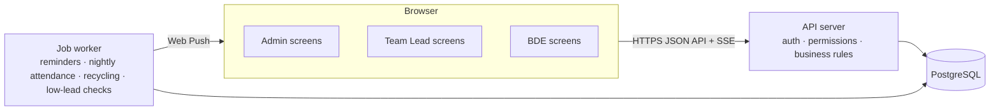
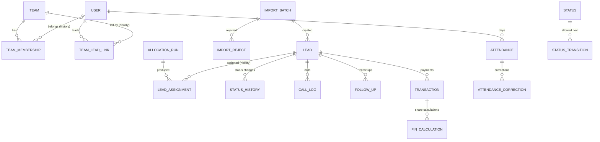
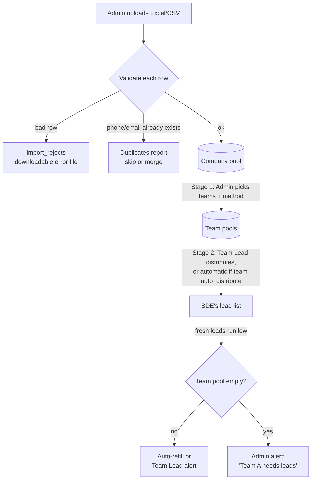
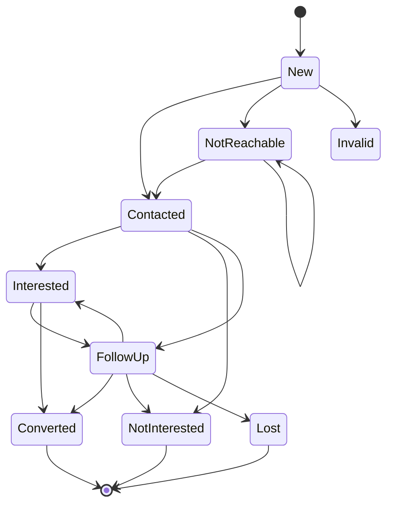
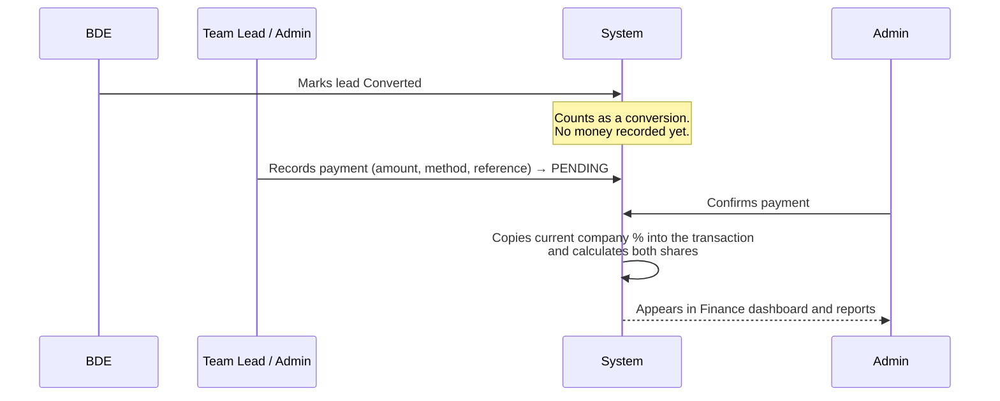

# BDE Lead Management & Allocation System — System Design

| | |
|---|---|
| Status | Draft v1 for review |
| Date | 18 Nov 2026 |
| Deployment model | One copy (one database) per company |
| Scope | Everything in the functional clarification email, the Financial Management module, and the extra features agreed after market research (§15) |
| Cost rule | Every tool and service must be free. Paid services are listed as future options only. |

Words used in this document:

- **Lead** is one person or company to contact. The screen label is configurable (Candidate, Student, Customer…), see §13.
- **Pool** is a set of leads not yet handed to a BDE: the *company pool* (uploaded, not given to a team) or a *team pool* (given to a team, not yet to a BDE).
- **Open lead** is a lead whose current status is not final (not Converted, Lost, Not Interested, DND, Invalid, Duplicate).
- **Fresh lead** is an assigned lead that the BDE has not touched yet (status `New`).
- **Setting** means a value Admin changes in the app, stored in the database. Nothing marked *(setting)* is hard-coded.

---

## 1. Technology stack (all free, open source)

| Layer | Choice | Why |
|---|---|---|
| Web app | React 18 + TypeScript + Vite + Tailwind CSS | Same as the team's proposal for the screens. |
| Charts | Recharts | Free, works with React. |
| API server | Node.js 22 LTS + TypeScript + Express | One language end to end, the same validation rules (Zod) shared by screens and server. |
| Database | PostgreSQL 16 | Partial unique indexes and row locking are what make "never assign one lead twice" safe (§5.6). |
| ORM / migrations | Prisma (+ raw SQL for the reporting views) | Typed queries, versioned migrations. |
| Background jobs | pg-boss (job queue stored in PostgreSQL) | Reminders, missing punch-out, recycling, nightly attendance. No Redis needed. |
| Live updates | Server-Sent Events | Notification bell and dashboards update without refresh. |
| Push notifications | Web Push (VAPID, `web-push` library) | Free follow-up reminders even when the tab is closed. |
| Excel / CSV | ExcelJS + Papa Parse | Upload and export. |
| PDF | pdfmake | Report export. |
| Tests | Vitest (unit), Supertest (API), Playwright (end-to-end) | All workflows tested with sample data (§16). |
| Version control | Git + GitHub | |
| Container | Docker + docker-compose | Same setup on every laptop and on the server. |

**Equivalent option:** the Team Lead's proposal (FastAPI + SQLAlchemy + Alembic + Pandas) fits this design just as well. Everything below is independent of the server language.

**Hosting warning for both stacks:** Vercel's free *Hobby* plan is for personal, non-commercial use only, so it cannot host a company project for free. Free options that allow company use:

| Need | Free option | Limit to know |
|---|---|---|
| Demo / review | Render free web service + Neon free PostgreSQL | Render sleeps after 15 min idle (≈1 min to wake). Neon: 1 GB per project. |
| Daily use by real BDEs | A company server or an always-free cloud VM, running the docker-compose setup | Must be confirmed with the company before deployment. |

---

## 2. Roles and what each can do

Three roles, in one hierarchy: **Admin → Team Lead → BDE**.

| Action | Admin | Team Lead | BDE |
|---|---|---|---|
| Create / deactivate users, create teams, move BDEs | ✅ | — | — |
| Change settings (§13) | ✅ | — | — |
| Upload leads, see duplicates and import errors | ✅ | — | — |
| Allocate company pool → teams | ✅ | — | — |
| Allocate team pool → BDEs | ✅ (any team) | ✅ (own teams) | — |
| Reassign / take back a lead | ✅ | ✅ (own teams) | — |
| See leads | All | Own teams | Own only |
| See full phone number | ✅ | ✅ (own teams) | Only when pressing Call / WhatsApp, logged (§12.3) |
| Update status, log call, add remark, schedule follow-up | ✅ | ✅ (own teams) | ✅ (own leads) |
| Punch in / out | — | ✅ (optional, setting) | ✅ |
| Correct attendance | ✅ | ✅ (own teams, setting) | Request only |
| Reports | Whole company | Own teams + their BDEs | Self |
| Export Excel / CSV / PDF | ✅ | ✅ (own teams) | Own summary only, never lead contact data |
| Leaderboard | All | All (setting) | All (setting) |
| Finance module | ✅ | — | — |
| Record a payment for a converted lead | ✅ | ✅ (setting, stays *Pending* until Admin confirms) | — |
| Audit log | ✅ | — | — |

Rules:

1. **Checked on the server, every request.** Each API route declares the permission it needs. Every lead/attendance/report query goes through one scoping function: a BDE only ever gets `owner = me`, a Team Lead only gets `team in (my active teams)`. Hiding a button is never the protection.
2. A **BDE belongs to exactly one active team** at a time. A BDE without an active team cannot receive leads.
3. A **Team Lead can lead several teams**. A team has at most one active Team Lead. If a team has none, Admin acts as its Team Lead.
4. Users are **never deleted**. They become *Inactive* (temporary) or *Exited* (left the company), so all history stays correct.

---

## 3. How the system fits together



- The browser only shows data and sends actions. **All rules run on the server**: allocation, status changes, attendance calculation, metrics, finance maths.
- The job worker is the same codebase started in "worker" mode. It runs scheduled jobs (§10.4).
- Every metric on every dashboard comes from **one metrics module** reading the same SQL views, so a number can never differ between two screens (§9.5).

---

## 4. Data model

Money is stored as **whole paise in a 64-bit integer** (₹50,000.00 → `5000000`). Percentages are stored as **basis points** (30% → `3000`, 12.5% → `1250`). This avoids decimal rounding errors.

Times are stored in UTC and shown in the company time zone *(setting, default Asia/Kolkata)*.



### 4.1 People and teams

| Table | Key columns | Notes |
|---|---|---|
| `users` | id, emp_code (unique), name, email (unique), phone, role (`ADMIN`/`TEAM_LEAD`/`BDE`), state (`ACTIVE`/`INACTIVE`/`EXITED`), password_hash, joined_on, exited_on, must_change_password | |
| `teams` | id, name (unique), state (`ACTIVE`/`INACTIVE`), auto_distribute (bool), created_at | |
| `team_memberships` | id, team_id, user_id, from_at, to_at | Partial unique index: one row with `to_at IS NULL` per BDE, so a BDE is in only one team. |
| `team_lead_links` | id, team_id, user_id, from_at, to_at | Partial unique index: one active Team Lead per team. |

### 4.2 Leads

| Table | Key columns | Notes |
|---|---|---|
| `lead_sources` | id, name, active | Website, Referral, Walk-in, Campaign X… |
| `import_batches` | id, file_name, uploaded_by, total_rows, accepted, duplicates, rejected, created_at | |
| `import_rejects` | batch_id, row_number, raw (JSON), reason | Downloadable as an error file. |
| `leads` | id, name, phone_e164, email, source_id, batch_id, custom (JSON), status_id, score, team_id (current, null = company pool), owner_id (current BDE, null = pool), attempt_count, recycle_count, dnd, last_activity_at, next_follow_up_at, status_changed_at, deleted_at, deleted_by, created_at, version | Unique index on `phone_e164` for non-duplicate leads. `version` stops two people saving over each other. |
| `custom_field_defs` | key, label, type (text/number/date/select), options, required, show_in_list, order | Domain-specific fields (course, product, city…). |
| `statuses` | id, key, label, category (`OPEN`/`WON`/`LOST`/`EXCLUDED`), counts_as_contact, needs_follow_up, required_fields (JSON list of field keys), colour, order, active | §7. `required_fields`: fields that must be filled before a lead can enter this status (e.g. Converted needs course and amount), §7.3. |
| `status_transitions` | from_status_id, to_status_id | If a status has no rows here, any change is allowed. |
| `status_history` | lead_id, from_status_id, to_status_id, by_user_id, remarks, at | Never updated or deleted. |
| `call_outcomes` | id, label, connected (bool), counts_as_attempt (bool), needs_follow_up (bool), order, active | Default: Answered, No answer, Busy, Switched off, Wrong number, Call back later. Separate from lead status (§8.1). |
| `call_logs` | lead_id, user_id, channel (`CALL`/`WHATSAPP`), direction (`OUT`/`IN`), started_at, duration_sec, outcome_id, status_before_id, status_after_id, remarks | One row per call even when the status doesn't change. |
| `follow_ups` | lead_id, user_id, type (`CALL`/`WHATSAPP`/`MEETING`/`TASK`), due_at, reason, state (`PENDING`/`DONE`/`CANCELLED`), reminded_at, completed_at | |
| `message_templates` | id, name, channel, body with `{{name}}`-style placeholders, active | WhatsApp click-to-chat texts. |
| `scoring_rules` | id, field, operator, value, points, active | §15 lead scoring. |
| `automation_rules` | id, trigger (`LEAD_ASSIGNED`/`STATUS_CHANGED`/`FOLLOW_UP_DONE`), condition (JSON), action (`CREATE_FOLLOW_UP`/`ASK_NEXT_FOLLOW_UP`), params (JSON: type, delay), active | Three fixed rules, switched on/off by Admin (§8.2). Not a general workflow builder. |
| `saved_views` | id, user_id (null = shared), page, name, filters (JSON), order | Built-in: All / Mine / Unassigned (§21.4). |
| `bulk_actions` | id, kind (`ASSIGN`/`STATUS`/`DELETE`/`IMPORT`), by_user_id, lead_count, before (JSON snapshot), at, undone_at, undone_by | Bulk changes can be undone for 30 days (§21.6). |

### 4.3 Allocation

| Table | Key columns | Notes |
|---|---|---|
| `allocation_runs` | id, level (`TEAM`/`BDE`), method (`EQUAL`/`WORKLOAD`/`MANUAL`/`AUTO_REFILL`/`RECYCLE`), started_by, params (JSON), lead_count, created_at | One row per "Distribute" click or automatic run. |
| `lead_assignments` | id, lead_id, level, team_id, user_id (null for TEAM level), run_id, assigned_by, assigned_at, reason (JSON: method, score, load, match, perf, or the manual override reason), over_max (bool), ended_at, end_reason (`REASSIGNED`/`USER_INACTIVE`/`USER_EXITED`/`TRANSFERRED`/`RECYCLED`/`CLOSED`) |
| `user_match_values` | user_id, field_key, value | What each BDE can handle for matching (§5.8), e.g. language = Tamil. |
| `allocation_limits` | scope (`COMPANY`/`TEAM`/`USER`), scope_id, max_open, max_per_day | Most specific scope wins. | **Partial unique index `(lead_id, level) WHERE ended_at IS NULL`**: the database itself refuses a second open assignment. |

### 4.4 Attendance

| Table | Key columns | Notes |
|---|---|---|
| `attendance` | id, user_id, work_date, punch_in_at, punch_out_at, worked_min, day_status (`PRESENT`/`HALF_DAY`/`ABSENT`/`LEAVE`/`HOLIDAY`/`WEEK_OFF`), late, early_out, missing_punch_out, punch_in_ip, location (optional) | Unique `(user_id, work_date)`. |
| `attendance_corrections` | attendance_id, requested_by, approved_by, before (JSON), after (JSON), reason, state, at | |
| `holidays` | date, name | |
| `time_off` | user_id, from_date, to_date, kind (`LEAVE`/`OTHER`), entered_by | Simple marking by Team Lead/Admin, so planned absence is not counted as absent and blocks allocation. |

### 4.5 Targets, settings, notifications, audit

| Table | Key columns |
|---|---|
| `targets` | scope (`COMPANY`/`TEAM`/`USER`), scope_id, metric (calls, contacts, conversions, conversion_pct, revenue), period (`DAY`/`WEEK`/`MONTH`), value, from_date |
| `settings` | key, value (JSON), updated_by, updated_at. Every change is also written to `audit_log`. |
| `notifications` | user_id, type, title, body, link, read_at, created_at |
| `push_subscriptions` | user_id, endpoint, keys, created_at |
| `audit_log` | actor_id, action, entity, entity_id, before (JSON), after (JSON), ip, at. The app has no route that edits or deletes rows here. |

### 4.6 Finance

| Table | Key columns | Notes |
|---|---|---|
| `transactions` | id, kind (`REVENUE`/`INVESTMENT`), lead_id (optional, must be a `WON` lead), amount_paise, method, reference_no, received_on, state (`PENDING`/`CONFIRMED`/`CANCELLED`), recorded_by, confirmed_by, confirmed_at, company_share_bp, company_share_paise, remaining_paise, notes | Shares are copied in at confirmation (§11.3). |
| `fin_calculations` | id, type (`REVENUE_SHARE`/`PROFIT_SHARE`/`PERCENT_OF`/`DISCOUNT`/`CHANGE`/`GROWTH`), inputs (JSON), percent_bp, result_paise, remaining_paise, transaction_id (optional), period_from, period_to, by_user_id, at | Never updated or deleted. |

---

## 5. Lead allocation

### 5.1 Flow



### 5.2 Upload and validation

1. Admin uploads `.xlsx` or `.csv` (max size *(setting, default 10 MB)*) and maps file columns to fields (name, phone, email, source, custom fields). The mapping can be saved for next time.
2. For each row the server checks: required fields present, phone becomes a valid number (normalised to `+91XXXXXXXXXX` format, default country *(setting)*), email format, select-field values allowed.
3. **Duplicate check:** same normalised phone, or same email, against (a) other rows in the same file and (b) existing leads. Duplicates are not created. The report shows the existing lead's status and owner, and Admin can choose *skip* (default) or *merge* (fill empty fields on the existing lead, recorded in history).
4. Result: "*1,240 rows: 1,180 added, 45 duplicates, 15 rejected*", with both lists downloadable.
5. Each lead gets its **score** (§15) and lands in the company pool.

### 5.3 Stage 1: company pool → teams (Admin)

Admin chooses: which leads (all in pool, or filter by batch / source / score / custom field), how many, which teams, and the method *(setting gives the default)*:

| Method | Rule |
|---|---|
| **Equal** | Each team gets ⌊N ÷ k⌋. The remainder goes one each to teams in a **rotating order** (stored), so the same team does not always get the extra lead. 300 to 3 teams → 100 / 100 / 100. 301 → 101 / 100 / 100, and next time the extra goes to the next team. |
| **By capacity** | Each team's share is proportional to its free capacity = Σ over eligible BDEs of (cap − open leads). Rounded with the largest-remainder method so the total is exactly N. |
| **Manual** | Admin types a number per team. The total cannot exceed the leads selected. |

Before saving, a **preview** shows the numbers per team. Leads are handed out highest score first, then oldest first.

### 5.4 Stage 2: team pool → BDEs (Team Lead, or automatic)

Two ways, both always available:

| | Manual | Automatic |
|---|---|---|
| Who decides | Team Lead / Admin | The system, by the rules in §5.7 |
| How | (a) Tick leads → "Assign to Priya", or (b) type a count per BDE | "Distribute" with an automatic method, or a trigger (auto-refill, upload with "send straight to BDEs", recycling) |
| Max limit | May go over **with a warning and a typed reason**, recorded in the audit log ("Arun will be at 55 / 50") | **Never** goes over |
| Inactive / exited BDE | Blocked | Blocked |

Automatic methods *(setting: default method per team)*:

| Method | Rule |
|---|---|
| **Smart** (default) | Score per eligible BDE, §5.7. |
| **Equal** | Round robin with rotating start, capped per BDE. 100 to 3 BDEs → 34 / 33 / 33. Same as Smart with only fairness counting. |
| **Workload** | "Fill the lowest first". Give each new lead to the eligible BDE with the fewest open leads, never above the max. Example: open leads 10, 30, 0 and 60 new leads → they end at 33, 33, 34 (gets +23, +3, +34). Same as Smart with only room-left counting. |

If not all leads fit, the rest **stay in the team pool**. The screen says why ("*20 leads not given: every eligible BDE is at their max*", "*3 Tamil leads waiting: no Tamil BDE present*").

### 5.7 Automatic allocation algorithm

Rule-based, not AI: the same input always gives the same result, every assignment stores its reason, and it costs nothing to run.

**Limits per BDE** *(settings; per-BDE override → team default → company default)*:

| Limit | Default |
|---|---|
| Max open leads at one time | 50 |
| Max new leads per day | 40 |

**Leads are placed one at a time**, best first: highest score, then oldest.

**Step 1: filter.** A BDE is eligible only if *all* are true:

1. active and a member of this team;
2. present today and not on leave / holiday / week-off *(punch-in requirement is a setting, default on)*;
3. open leads < their max;
4. leads given today < their daily max;
5. not a previous owner of this lead (recycled leads never go back);
6. has the required value for every matching rule set to *must match* (§5.8).

No one left → the lead stays in the pool, and the reason is shown to the Team Lead.

**Step 2: score each eligible BDE, 0–100.**

```
score = W_load  × (1 − open ÷ max)                 room left, 0..1
      + W_match × (matching "prefer" fields ÷ all "prefer" fields)   0..1
      + W_perf  × performance                       0..1
```

| Weight *(setting)* | Default | Meaning |
|---|---|---|
| W_load | 60 | Fairness / room left |
| W_match | 25 | Language, city, product match (only when matching is on, §5.8). When off, its 25 is added to W_load. |
| W_perf | 15 | Small bonus for better converters |

**Performance** = BDE's conversion % over the last 30 days ÷ (2 × team average), capped at 1. So the team average scores 0.5. A BDE with fewer than *(setting, default 20)* counted leads in that window gets **0.5** (neutral), so new joiners are not starved.

**Step 3: pick** the highest score. Tie → the BDE who waited longest since their last assigned lead. Save the assignment with its reason, for example `{"method":"SMART","score":79,"load":"10/50","match":["language"],"perf":0.4}`, then update that BDE's counts **before the next lead is scored**, so work spreads out by itself.

**Example**, 3 Tamil leads, matching on:

| BDE | Open / max | Tamil | Perf | Score for lead 1 |
|---|---|---|---|---|
| Meena | 10 / 50 | ✓ | 0.4 | 60 × 0.80 + 25 + 15 × 0.4 = **79** → gets it |
| Priya | 38 / 50 | ✓ | 1.0 | 60 × 0.24 + 25 + 15 × 1.0 = **54** |
| Ravi | 30 / 50 | ✗ | 0.7 | 60 × 0.40 + 0 + 15 × 0.7 = **35** |

**Preview before saving:** the distribute screen shows, per BDE, how many they will get and why (room, match, performance), plus who was skipped and why.

**Triggers:**

| Trigger | Default |
|---|---|
| Team Lead presses Distribute | always available |
| Auto-refill when a BDE's fresh leads reach the low mark | **off**, switchable per team; when off the Team Lead gets a "needs leads" alert |
| Upload with "send straight to teams and BDEs" | off |
| Recycled leads (§7.3) | on, using the team's method |

**Safety:** one database transaction, leads locked with `FOR UPDATE SKIP LOCKED`, and the partial unique index of §5.6.

### 5.8 Lead–BDE matching (extra feature, off by default)

Not in the company brief, kept as an option (see OPEN-QUESTIONS.md).

- Admin picks which lead fields to match on (e.g. language, city, product), and for each field whether it is **prefer** (bonus in the score) or **must** (filter in Step 1).
- Each BDE profile has the values they can handle for those fields (e.g. languages: Tamil, English).
- A lead with an empty value for a field matches anyone for that field.
- Default when switched on: **prefer**, so leads never get stuck.

### 5.5 When a BDE runs out of leads

1. After every status change, the server counts the BDE's **fresh leads**.
2. When it reaches the low mark *(setting, default 0; e.g. 5 to refill early)*:
   - the BDE sees "*No new leads. Your Team Lead has been told.*" (follow-ups due are still listed);
   - if the team has **auto-distribute on** and the team pool has leads, the system gives the BDE a refill of *(setting, default 20)* leads using the workload rule, and logs an `AUTO_REFILL` run;
   - otherwise the Team Lead gets a notification and the BDE shows in a **"Needs leads"** panel.
3. If the team pool is empty, Admin gets "*Team A needs leads (2 BDEs empty, pool 0)*" in the Admin dashboard's **Lead requests** panel. Admin can upload more, allocate from the company pool, or move leads from another team's pool.
4. Alerts are sent once per BDE per day (no repeats every minute).
5. Moving leads **between teams** only takes leads still in a team pool, or leads Admin explicitly takes back. A lead a BDE is working is never moved silently.

### 5.6 Never assigning one lead twice

1. Allocation runs inside **one database transaction**. Leads are picked with `SELECT … FOR UPDATE SKIP LOCKED`, so two Team Leads clicking "Distribute" at the same moment get different leads.
2. The **partial unique index** on `lead_assignments` makes a second open assignment impossible even if the code had a bug.
3. Re-assigning always **ends** the old assignment (`ended_at`, `end_reason`) and **adds** a new row. Nothing is overwritten, so "who had this lead, when, and why it moved" is always answerable.
4. Duplicate leads are stopped at upload (§5.2), so the same person cannot be two leads in two BDEs' lists.

---

## 6. BDE absent, inactive, transferred, or leaving

| Situation | What the system does automatically | What a person can do |
|---|---|---|
| **Absent today** (no punch-in by the cut-off *(setting)*, or time off) | No new leads today. Their follow-ups due today appear in the Team Lead's **At risk** list. | Team Lead can move some or all of those leads to someone else. |
| **Inactive** (temporary) | Cannot log in. No new leads. Their open leads appear in the Team Lead's **Unattended leads** list. | Team Lead/Admin reassigns them, or leaves them until the BDE is back. |
| **Exited** (left) | Cannot log in. All open leads are **returned to the team pool** *(setting: auto-return, default on)* with `end_reason = USER_EXITED`. Pending follow-ups move with the lead. | Team Lead redistributes them. |
| **Transferred** to another team | Membership history closes the old team and opens the new one. | Admin chooses at the moment of transfer: open leads **stay in the old team's pool** (default) or **go with the BDE**. |
| **Team Lead inactive/exited** | Their teams show "*No Team Lead*" on the Admin dashboard. Admin can do everything a Team Lead can until a new one is linked. | Admin links a new Team Lead. |
| **Team deactivated** | Allowed only when it has no BDEs. Its pool returns to the company pool. | Admin moves BDEs first. |
| **BDE comes back** | Becomes eligible again from the next allocation. | |

Performance stays with the right person and team: every assignment row stores **both the BDE and the team at that time**, so moving a BDE never moves their old results.

---

## 7. Lead statuses and lifecycle

### 7.1 Default statuses (Admin can rename, add, hide, reorder)

| Status | Category | Counts as contacted | Notes |
|---|---|---|---|
| New | OPEN | no | Starting status. "Fresh". |
| Contacted | OPEN | yes | |
| Interested | OPEN | yes | Suggests a follow-up. |
| Follow-up Required | OPEN | yes | A follow-up date is required. |
| Not Reachable | OPEN | no | Increments attempts (§7.3). |
| Converted | WON | yes | Counts as a conversion. Does **not** mean money was received (§11.4). |
| Not Interested | LOST | yes | |
| Lost | LOST | depends | |
| Do Not Call | EXCLUDED | — | Never allocated again. |
| Invalid Number | EXCLUDED | — | Removed from the conversion denominator. |
| Duplicate | EXCLUDED | — | Removed from the conversion denominator. |

### 7.2 Default allowed changes



Any status can also go to *Do Not Call*. Only Team Lead/Admin can reopen a final status (WON/LOST/EXCLUDED), and the reopen is recorded with a reason.

### 7.3 Rules on every status change

1. Recorded in `status_history` with user, time and remarks. Remarks required *(setting, per status)*.
2. The server rejects changes not in `status_transitions` ("*Converted → New is not allowed*").
3. A status marked `needs_follow_up` requires a follow-up date in the same save.
4. **Not Reachable** adds 1 to `attempt_count`. When it reaches *(setting, default 3)* attempts spread over at least *(setting, default 24 h)*, the lead is **recycled**: its assignment ends (`RECYCLED`), it returns to the team pool, and it is never given back to the same BDE. After *(setting, default 2)* recycles it becomes **Lost**.
5. The lead's `last_activity_at` and score are updated.
6. Two people editing the same lead: the second save is refused ("*This lead was changed by Priya at 11:42, reload*"), using the `version` column.

---

## 8. Follow-ups and reminders

1. BDE opens a lead → *Schedule follow-up* → date, time, reason. Quick picks come from the interval setting per status (e.g. *Interested → tomorrow 11:00*).
2. Reminder *(setting, default 15 min before)*: in-app notification, a sound, and a Web Push message if the BDE allowed it.
3. **Overdue** = due time passed and not done. Shown red at the top of the BDE dashboard, and counted on the Team Lead's dashboard per BDE.
4. A follow-up is **done** only by logging what happened (call outcome or status change). A new follow-up can be booked in the same step.
5. Leads with a due follow-up come before fresh leads in the BDE's "Next to call" list.
6. When a lead is reassigned, its pending follow-ups move to the new owner, and the new owner gets a notification.
7. Future (paid) channels: email, SMS, WhatsApp Business API reminders.
8. **Type and time filters** (from Pipedrive / HubSpot): every follow-up has a type (Call, WhatsApp, Meeting, Task). The follow-ups page has tabs **Overdue / Due today / Upcoming**, a type filter, and a **list or week-calendar** view.
9. **Quick picks skip non-working days** (from Close): "Tomorrow 11:00" moves to the next working day using holidays and week-offs from attendance (§10).

### 8.1 Call outcome vs lead status

A call always records a **call outcome** (§13 *Calls*): Answered, No answer, Busy, Switched off, Wrong number, Call back later. Only **Answered** asks for a new lead status. Not-connected outcomes add 1 to `attempt_count` and leave the status unchanged, so the funnel isn't polluted by "Not reachable" every time a phone rings out. *Call back later* requires a follow-up time. Reports can then show connect rate by hour and by BDE.

### 8.2 Automatic follow-up rules *(setting, all on by default)*

| Rule | When | Does |
|---|---|---|
| First call | A lead is assigned to a BDE | Creates a Call follow-up due within the first-call target (default 30 min, working hours only). |
| Next step | Status changes to one with `needs_follow_up` | Creates the follow-up from the status's default interval if the BDE didn't book one. |
| Keep it moving | A follow-up is completed and the lead is still OPEN | Asks for the next follow-up before saving (can be skipped with a reason). |

(Pipedrive's six popular automation templates are all variants of these.)

---

## 9. Performance and conversion percentage

### 9.1 Which leads count (the denominator)

A lead counts **once** for a BDE and once for the team, based on its assignment rows:

> **Counted leads** = leads assigned in the period
> − leads now in an **EXCLUDED** status (Invalid, Duplicate, DND)
> − leads that were **taken away before the BDE did anything** (no call or status change by that BDE).

If a lead was worked by BDE A, then reassigned to BDE B who converted it, it counts in **both** denominators, but the conversion is credited only to **B** (the owner when it became Converted). The team gets the conversion for the team that held it at that moment.

### 9.2 Formulas

| Metric | Formula |
|---|---|
| BDE conversion % | conversions credited to the BDE ÷ BDE's counted leads × 100 |
| Team conversion % | conversions credited to the team ÷ team's counted leads × 100 |
| Company conversion % | all conversions ÷ all counted leads (leads allocated to a team, not just uploaded) × 100 |
| Contact rate % | leads with at least one *counts as contacted* status ÷ counted leads × 100 |
| Follow-up completion % | follow-ups done on or before due time ÷ follow-ups due × 100 |
| Pending leads | open leads that are fresh (`New`) |
| Attendance % | present days (half-day = 0.5) ÷ working days in the period (from joining date, excluding holidays, week-offs and time off) × 100 |

All percentages are rounded to 1 decimal place **only when shown**. Totals are calculated from raw counts, never by averaging percentages.

### 9.3 Period rule *(setting)*

| Option | Meaning | Use |
|---|---|---|
| **Cohort** (default) | "Of the leads assigned in March, how many have converted so far?" | Fair comparison between BDEs. |
| **Activity** | "Conversions that happened in March ÷ leads assigned in March" | Monthly sales numbers. |

The chosen rule is shown next to every percentage ("*Cohort: leads assigned 1–31 Mar*").

### 9.4 Metrics per role

| BDE | Team Lead | Admin |
|---|---|---|
| Leads assigned, contacted, interested, follow-ups done / due / overdue, conversions, conversion %, pending, not interested, not reachable, attendance summary, target progress, leaderboard rank | Team pool received, distributed, team conversions, team conversion %, BDE comparison table and chart, pending follow-ups per BDE, team attendance, "needs leads" and "at risk" lists | Uploaded, allocated, unallocated, company conversion %, team comparison, Team Lead comparison, active / inactive BDEs, attendance summary, pending leads per team, lead requests, conversion by source, finance summary (§11) |

### 9.5 One source of truth

- One server module `metrics` builds every number from SQL views (`v_counted_leads`, `v_conversions`, `v_attendance_days`). Dashboards, reports and exports all call it.
- **Targets** come from the `targets` table. Thresholds (e.g. below 60% of target = red) are settings.
- An automated test seeds a fixed dataset and checks every number on all three dashboards is identical to the expected figures (§16).

---

## 10. Attendance

### 10.1 Punch in / out

1. BDE presses **Punch In**. The server records **server time** (the browser's clock is never trusted), the IP address, and the location if the setting asks for it and the BDE allows it.
2. One punch-in per day. A second press shows "*Already punched in at 09:12*".
3. **Punch Out** records the time and calculates worked minutes.
4. Optional *(setting)*: only allow punching from office IP addresses.

### 10.2 Rules *(all settings)*

| Setting | Default |
|---|---|
| Shift start / end | 09:30 / 18:30 |
| Week-offs | Sunday |
| Late after | start + 10 min grace |
| Early out before | end − 10 min grace |
| Full day minimum | 8 h |
| Half day minimum | 4 h |
| Absent cut-off (for allocation and "absent today") | start + 2 h |
| Missing punch-out auto-close | 23:59 |
| Missing punch-out counts as | Half day until corrected |

### 10.3 Day status calculation

| Case | Result |
|---|---|
| Holiday / week-off / time off | HOLIDAY / WEEK_OFF / LEAVE (never absent) |
| Before joining date or after exit date | not a working day |
| No punch-in | ABSENT |
| Worked ≥ full-day minimum | PRESENT |
| Half-day minimum ≤ worked < full day | HALF_DAY |
| Worked < half-day minimum | ABSENT |
| No punch-out | `missing_punch_out = true`, status from the setting above |
| Late / early | Flags on top of the status (a late day can still be PRESENT) |

Night shifts crossing midnight belong to the date of the punch-in.

### 10.4 Jobs

| Job | When |
|---|---|
| Follow-up reminders | every minute |
| Absent-today check (blocks allocation, Team Lead alert) | at the absent cut-off |
| Missing punch-out close | at the auto-close time |
| Final day status for everyone | 00:30 for the previous day |
| Low-lead check (safety net for §5.5) | every 15 min during shift |
| Recycling check (§7.3) | hourly |

### 10.5 Corrections

BDEs **cannot edit** attendance. They can send a **correction request** with a reason. A Team Lead (own team, if allowed by setting) or Admin approves or rejects it. The before and after values are stored in `attendance_corrections` and `audit_log`.

---

## 11. Financial Management (Admin only)

### 11.1 Calculators

| Calculator | Inputs | Output | Example |
|---|---|---|---|
| **Revenue share** | Total revenue, company % *(setting, default 30)* | Company share = revenue × %, remaining = revenue − company share | ₹50,000 → ₹15,000 / ₹35,000 |
| **Profit share** | Investment, revenue, company % | Profit = revenue − investment, then company share = profit × %, remaining = profit − share | ₹20,000 / ₹50,000 → profit ₹30,000 → ₹9,000 / ₹21,000 |
| **Percent of** | Amount, % | Amount × % | 18% of ₹2,500 = ₹450 |
| **Discount** | Price, discount % | Discount, final price | ₹10,000, 15% → ₹1,500 off, ₹8,500 |
| **Increase / decrease** | Amount, % up or down | New amount | ₹40,000 + 12% = ₹44,800 |
| **Growth** | Previous, current | (current − previous) ÷ previous × 100 | ₹80,000 → ₹1,00,000 = +25% |

Rules:

1. Company % + remaining % must equal 100. Only the company % is entered, and the other is shown.
2. Rounding: the share is rounded **half up to the nearest paisa**, and the remaining part is **total − share**, so the two always add up exactly.
3. **Profit ≤ 0:** no shares are calculated. The result says "*Loss of ₹4,000, no profit to share*".
4. **Growth with previous = 0:** shown as "*n/a (no previous value)*", never ∞ or an error.
5. Negative amounts are refused, except where the calculator allows them (increase/decrease result).
6. **Revenue sharing and profit sharing are separate calculators** with separate history types.

### 11.2 History

Every calculation saves a `fin_calculations` row: type, inputs, %, result, remaining, user, time, and the linked transaction or period if any. History is searchable by type, date and user, and exportable. It cannot be edited or deleted, and a wrong calculation is simply calculated again.

### 11.3 Transactions and the link to converted leads



- A revenue transaction can only link to a lead whose status is **WON**. Admin can also record revenue with no lead (other income) and **investment** entries.
- **Only `CONFIRMED` transactions** count in finance totals. Pending ones are listed separately.
- The company % is **copied into the transaction when it is confirmed**. Changing the % later does not change old figures. A banner explains "*Shares use the % in force on the confirmation date*".
- A confirmed transaction cannot be edited. It can be **cancelled with a reason** (and re-entered), all in the audit log.
- Converted leads with no confirmed payment after *(setting, default 7)* days appear in a "*Converted, payment not recorded*" list.

### 11.4 Finance dashboard

Cards: total confirmed revenue, total company share, total remaining share, total investment, profit (revenue − investment), pending payments. Charts: monthly revenue vs investment, share split, revenue by team / source. Tables: recent transactions, recent calculations. Filters: date range, team, source.

Finance routes require the `finance` permission, which only Admin has. Team Leads and BDEs never receive these numbers from the API.

---

## 12. Security and data protection

1. **Login:** email or employee code + password. Passwords hashed with bcrypt. 5 failed tries → 15 min lock. First login forces a password change.
2. **Sessions:** short access token (15 min) + refresh token in an httpOnly, secure cookie. Deactivating a user ends their sessions immediately.
3. **Phone masking:** BDE screens show `98XXXXX210`. Pressing **Call** or **WhatsApp** asks the server for the full number just for that action and logs it. This, plus no lead export for BDEs, protects company data when a BDE leaves.
4. **Input checks** on every request (Zod). Upload files are checked by content, not just extension.
5. **Rate limits** on login, upload and export.
6. **Audit log** for: logins, user/team changes, settings changes, allocation runs, reassignments, status reopens, attendance corrections, exports, number reveals, all finance actions.
7. **Personal data:** only what the company needs. Lead data can be exported or deleted by Admin on request (India's DPDP Act 2023).
8. **Backups:** daily database dump (`pg_dump`) kept for 14 days, plus a monthly copy.

---

## 13. Admin settings (stored in the database, changed in the app)

| Area | Settings |
|---|---|
| Company | Name, logo, time zone, default country code, **labels** (what to call a "Lead": Candidate / Student / Customer), currency |
| Teams & people | Teams, Team Leads, BDEs, default lead cap, per-user cap |
| Allocation | Default method for Stage 1 and Stage 2, max open leads and max new leads per day (company / team / BDE), Smart weights (load / match / performance), performance window and minimum leads, punch-in required for allocation, low-lead mark, auto-refill on/off per team and size, auto-return on exit, matching fields and prefer/must (§5.8) |
| Leads | Custom fields, sources, duplicate matching rule (phone / email / phone or email), scoring rules, trash retention (default 30 days) |
| Statuses | Names, colours, colour style (text / dot / badge), order, category, contacted flag, follow-up required, remarks required, **required fields**, allowed transitions |
| Calls | **Call outcomes** (label, connected, counts as attempt, needs follow-up), power dialer **wrap-up seconds** (default 5), **leave out leads already called today** (default on), pause allowed |
| Automation | The three rules in §8.2, each on/off, with the follow-up delay |
| Recycling | Max not-reachable attempts, minimum spread, max recycles |
| Follow-ups | Reminder time before, default interval per status, overdue highlight |
| Attendance | All rules in §10.2, holidays, office IP list, location capture |
| Performance | Conversion period rule (cohort / activity), targets per company / team / BDE / period, colour thresholds, leaderboard visibility |
| Reports | Which roles can export what |
| Messages | WhatsApp templates |
| Finance | Company share %, payment-not-recorded reminder days, who may record payments |

**Not a setting (developer-controlled):** login and security rules, permissions code, database structure, the formulas' definitions (only their options are settings).

---

## 14. Reports and exports

| Report | Roles | Filters |
|---|---|---|
| Daily / weekly / monthly performance | BDE (self), TL (team + BDEs), Admin (all) | Date range, team, BDE, source |
| Allocation report (runs, who got how many) | TL, Admin | Date, team, method |
| Lead status breakdown and funnel | TL, Admin | Date, team, source, status |
| Follow-up report (done, due, overdue) | All (scoped) | Date, team, BDE |
| Attendance report (present, half, absent, late, early, missing punch-out) | All (scoped) | Month, team, BDE |
| Conversion by source / batch | Admin | Date, source, batch |
| Leaderboard | Per setting | Day, week, month |
| Lead history (assignments + status + calls) | TL, Admin | Lead |
| Finance reports | Admin | Date, team, source, type |

Formats: **Excel (.xlsx), CSV, PDF**. Every export uses the same `metrics` module as the screen, and adds a footer with the filters, the period rule, and the time generated.

---

## 15. Extra features (from market research)

| Feature | How it works |
|---|---|
| Click-to-call | `tel:` link opens the phone's dialer. On returning, the app asks for the outcome and fills in the call duration from a timer. |
| WhatsApp | `wa.me` link with a chosen template, name filled in. Logged as a WhatsApp contact. |
| Smart allocation | Eligibility (§5.4) skips absent / on-leave / at-cap BDEs. Optional rule: match lead language or city to the BDE. |
| Lead sources | Required on upload. Reports show conversion % per source. |
| Duplicates | §5.2: report, skip or merge, history kept. |
| Attempts and recycling | §7.3. |
| Do Not Call | Status in the EXCLUDED category, never allocated again. |
| Leaderboard | Rank by conversions, conversion %, calls, target progress. Day / week / month. |
| Lead scoring | Admin rules such as "Source = Referral → +20", "Interested → +30", "3 failed attempts → −15". Higher score is called first. |
| Activity timeline | On each lead: every assignment, status change, call, follow-up, remark and payment, newest first. |
| Number masking | §12.3. |
| Import error file | §5.2. |
| Labels and custom fields | §13. Lets another company use the app for its own kind of lead. |
| Web Push reminders | §8. |

**Paid, for later:** call recording, auto / predictive dialer, IVR (needs a telephony provider such as Exotel), WhatsApp Business API automation, SMS, AI scoring.

## 15.1 Additions from the CRM research (Nov 2026)

Source: [CRM-RESEARCH.md](CRM-RESEARCH.md). Pipedrive and HubSpot were walked through in trial accounts; the others from public docs.

| # | Feature | Where it lives | Learned from |
|---|---|---|---|
| 1 | Call outcome separate from lead status | §8.1, `call_outcomes`, `call_logs` | HubSpot |
| 2 | **Allocation history page**: every run and manual assignment, with method, who, count, and each lead's reason; filter by date, team, method | New page for Admin and Team Lead, reads `allocation_runs` + `lead_assignments` | Pipedrive automatic-assignment History |
| 3 | Power dialer: **Reschedule** (pick a time, lead leaves today's queue), **Pause**, a **wrap-up countdown** before the next call, queue leaves out leads already called today unless a follow-up is due | BDE power dialer, settings §13 *Calls* | HubSpot task queues, TeleCRM, Close |
| 4 | Lead page: **status bar with "N days in this status"**, **Converted / Lost** buttons, one **composer** (Note, Follow-up, Call, WhatsApp), **next follow-up pinned** on top, **history filters** (All, Calls, Status, Notes, Assignments) | Lead detail panel; `leads.status_changed_at` | Pipedrive deal page |
| 5 | **Required fields per status**: e.g. Converted needs course and amount; the save is blocked on the server until they are filled | `statuses.required_fields`, checked in the status-change service (§7.3) | Zoho Blueprint |
| 6 | Follow-ups page with Overdue / Due today / Upcoming, type filter, list or week calendar; quick picks skip holidays | §8 items 8–9 | Pipedrive, HubSpot, Close |
| 7 | **Compare with last week / last month** on every KPI and in the BDE table | Metrics module (§9.5) returns the previous period too | Close, HubSpot dashboard |
| 8 | **Admin setup checklist** with % progress and a time estimate per task (company details, teams, BDEs, statuses, first upload, targets); **one-click "Remove sample data"** | Admin dashboard until finished | Pipedrive, HubSpot start guides |
| 9 | Built-in views **All / Mine / Unassigned** on leads, plus saved views | `saved_views` | HubSpot |
| 10 | **Trash and undo**: deleted leads go to a trash for 30 days; bulk assign / status change / delete / import can be undone for 30 days from the history page | `leads.deleted_at`, `bulk_actions` | Pipedrive Restore data |
| 11 | Three automatic follow-up rules | §8.2 | Pipedrive automations |
| 12 | Duplicate matching rule chosen by Admin | §13 *Leads* | Pipedrive merge duplicates |
| 13 | Status colour style (text, dot or badge) chosen by Admin | §13 *Statuses* | HubSpot pipeline settings |

All of these are free to build: they need no paid service.

**Later (P2):** sequences (multi-step follow-up plans that stop when the lead converts), bulk reschedule for Team Leads, custom report builder, product/course and expected amount on converted leads feeding finance ("expected collections by month").

---

## 16. Testing

| Level | What |
|---|---|
| Unit | Allocation maths (equal with rotating remainder, workload fill, caps), conversion formulas, attendance day status, every finance calculator incl. rounding, loss, zero-previous growth. |
| API | Every route: correct role allowed, other roles refused (403), Team Lead can't see another team's lead, BDE can't see another BDE's lead, finance hidden from TL/BDE. |
| Concurrency | Two Stage-2 distributions started at the same time on the same pool → no lead assigned twice. |
| Scenario (seeded data) | 3 teams, 3 Team Leads, 10 BDEs, 300 leads, 30 days. Run every workflow in §17 and compare all dashboard numbers to a hand-calculated sheet. |
| End-to-end | Playwright: upload → allocate → call → convert → record payment → confirm → finance dashboard. |

---

## 17. Answers to "Expected Understanding" (§12 of the brief)

| Question | Where |
|---|---|
| How Admin creates teams and assigns Team Leads and BDEs | §2, §4.1, §6 |
| How candidate data moves Admin → teams → BDEs | §5.1–5.4 |
| How BDE / Team Lead / Admin conversion % are calculated | §9.1–9.3 |
| How attendance is recorded and monitored | §10 |
| What happens when a BDE completes all leads | §5.5 |
| Leads when a BDE is absent or deactivated | §6 |
| How statuses and follow-ups are maintained | §7, §8 |
| How dashboards and reports come from the database | §9.5, §14 |
| Which settings Admin can change | §13 |
| How duplicates are prevented and history kept | §5.2, §5.6, §4 (history tables) |

---

## 18. Missing scenarios found (beyond the brief)

1. Same phone number uploaded twice in one file, or already in the system → §5.2.
2. Two Team Leads distributing at the same moment → §5.6.
3. Uneven split remainder always going to the same team/BDE → rotating remainder, §5.3.
4. Not enough cap left for all leads → leftovers stay in pool, §5.4.
5. Lead reassigned after the old BDE worked it: who gets credit? → §9.1.
6. Converted but never paid → §11.3 reminder list.
7. Company % changed after payments were already confirmed → snapshot rule, §11.3.
8. Profit is zero or negative → §11.1.
9. Growth from a previous value of zero → §11.1.
10. BDE forgets to punch out → §10.2–10.3.
11. Days before joining or after exit counted as absent → excluded, §10.3.
12. Night shift crossing midnight → §10.3.
13. Team Lead leaves → §6.
14. Team with no Team Lead → Admin acts, §2.
15. BDE transferred with open leads → Admin chooses, §6.
16. Lead never reachable → attempts and recycling, §7.3.
17. Customer asks never to be called → Do Not Call, §7.1.
18. Two people edit the same lead → version check, §7.3.
19. BDE copies all numbers before leaving → masking + no export, §12.3.
20. Wrong status set by mistake on a final status → reopen by TL/Admin with reason, §7.2.
21. Follow-ups of a reassigned lead → move with it, §8.
22. Wrong browser / phone clock at punch-in → server time only, §10.1.
23. Changing a setting mid-month → settings changes are audited, and finance uses snapshots. Metrics always use current definitions, and the period rule is printed on reports.

---

## 19. Questions to confirm with the company

All open questions, the industry-practice answer used until the company replies, and their status are tracked in [OPEN-QUESTIONS.md](OPEN-QUESTIONS.md). Questions marked 🔴 there change the database or formulas, so it's best to answer them before that module is built.

---

## 20. Build order (modules)

| # | Module | Done when |
|---|---|---|
| 1 | Project setup, login, roles, users, teams, audit log, settings store | Admin creates teams, Team Leads, BDEs; permissions tested. |
| 2 | Leads: custom fields, sources, upload, validation, duplicates, error file | 1,000-row file imports with correct counts. |
| 3 | Allocation Stage 1 + 2, allocation history page, bulk undo, concurrency safety | Seeded scenario: 300 → 100/100/100 → 34/33/33, concurrency test passes. |
| 4 | Lead work: statuses (incl. required fields), transitions, history, call outcomes, click-to-call, WhatsApp, timeline with filters, masking, trash | BDE works a lead end to end; a not-answered call doesn't change status. |
| 5 | Follow-ups (types, tabs, calendar), automatic follow-up rules, reminders, notifications, Web Push, jobs | Reminder arrives 15 min before; overdue shows; the three rules fire. |
| 6 | Attendance: punch, rules, day status, corrections | 30-day seeded month matches expected statuses. |
| 7 | Lead exhaustion, auto-refill, absence/inactive/exit/transfer handling, recycling | Each row of §6 tested. |
| 8 | Metrics module, three dashboards, targets, leaderboard, scoring | All dashboards agree with the hand-calculated sheet. |
| 9 | Reports and Excel / CSV / PDF export | Exports match screen numbers. |
| 10 | Finance: calculators, history, transactions, dashboard | All calculator tests incl. rounding and edge cases pass. |
| 11 | Polish, end-to-end tests, deployment, backups | Full Playwright flow passes on the deployed copy. |
